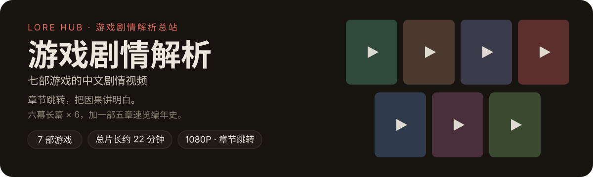

<p align="right"><a href="README.md">中文</a></p>

<p align="center">
  
</p>

<p align="center">
  <a href="https://lore.xiaosang.cc/">▶ Watch Online</a>
  ·
  <a href="https://github.com/holynova/lore-hub">GitHub Repository</a>
</p>

Lore Hub collects Chinese lore-explainer videos for seven games: one short film per game, told in chapters so the story's causes and consequences are easy to follow, with chapter navigation, speed control and downloadable originals. Merged on 2026-11-15 from seven standalone lore sites, each now living under its own subpath.

## Screenshot

<p align="center">
  
</p>

## The Seven Games

| Game | Subpath | In one line | Length |
|---|---|---|---|
| Elden Ring | [`elden-ring/`](https://lore.xiaosang.cc/elden-ring/) | The Golden Order's origins and the dawn of the stars | 6 chapters · 3:27 |
| The Witcher 3 | [`witcher-3/`](https://lore.xiaosang.cc/witcher-3/) | A thousand-mile search for Ciri under the Wild Hunt's shadow, and the Elder Blood's dawn | 6 chapters · 3:58 |
| GTA V | [`gta5/`](https://lore.xiaosang.cc/gta5/) | The Los Santos trio's loves and grudges, and the heist of the century | 6 chapters · 3:51 |
| Red Dead Redemption 2 | [`rdr2/`](https://lore.xiaosang.cc/rdr2/) | Outlaws at the end of the road, and a noble redemption | 6 chapters · 3:44 |
| Cyberpunk 2077 | [`cyberpunk-2077/`](https://lore.xiaosang.cc/cyberpunk-2077/) | Night City's meat grinder, and living toward death | 6 chapters · 3:36 |
| Dark Souls III | [`dark-souls-3/`](https://lore.xiaosang.cc/dark-souls-3/) | Ten thousand years of linking the fire, and the dawn of the ending | 6 chapters · 2:51 |
| Elden Ring Chronicle | [`elden-ring-video/`](https://lore.xiaosang.cc/elden-ring-video/) | An epic chronicle of the Lands Between in five quick chapters | 5 chapters · 1:05 |

Total runtime about 22 minutes; all films are 1080p, 30fps. **Contains main-story and ending spoilers.**

## Watching

- Each subpath's `index.html` is a public player: click a chapter card to jump to that timestamp, with speed control and downloadable originals.
- Narration and music live in each site's `assets/` alongside the repo; video composition sources (`composition.html`, `compositions/`) are kept in each site's directory too.

## Run Locally

No build step — start a static server and pick a game from the hub homepage:

```bash
python3 -m http.server 8080
# Open http://localhost:8080
```

The player uses the finished films straight from the repo, no rendering needed. Re-rendering a video requires installing the composition project's dependencies; see the notes inside each site.

## Structure

```
index.html            Hub homepage: 7 game cards
elden-ring/           Elden Ring (6 chapters, 3:27)
witcher-3/            The Witcher 3 (6 chapters, 3:58)
gta5/                 GTA V (6 chapters, 3:51)
rdr2/                 Red Dead Redemption 2 (6 chapters, 3:44)
cyberpunk-2077/       Cyberpunk 2077 (6 chapters, 3:36)
dark-souls-3/         Dark Souls III (6 chapters, 2:51)
elden-ring-video/     Elden Ring Chronicle (5 chapters, 1:05)
scripts/merge-lore.py Hub merge script (idempotent)
assets/PingFang.ttc   Shared font for the composition projects (pages use a system font stack)
```

Inside each game directory: `index.html` (player), finished `.mp4` film, `scenes_meta.json` (chapter info), `composition.html` + `compositions/` (composition sources), `assets/` (narration, music, illustrations).

## Disclaimer

The dramatized lore is the author's own edit and interpretation. Game characters, official assets and trademarks belong to their respective owners; this is an unofficial fan project.
