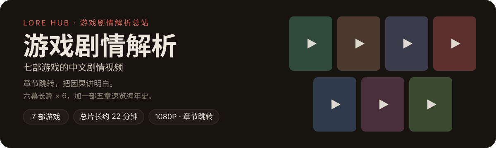
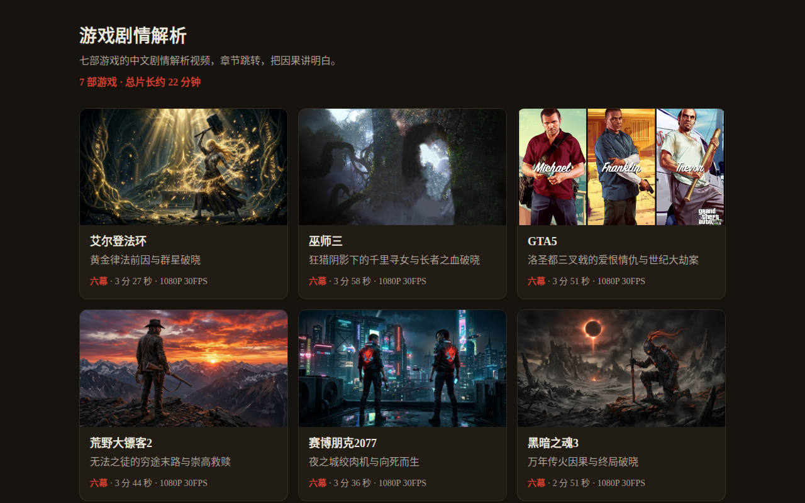

<p align="right"><a href="README.en.md">English</a></p>

<p align="center">
  
</p>

<p align="center">
  <a href="https://lore.xiaosang.cc/">▶ 在线观看</a>
  ·
  <a href="https://github.com/holynova/lore-hub">GitHub 仓库</a>
</p>

游戏剧情解析是七部游戏的中文剧情视频总站：每部游戏一支短片，用分幕叙事把主线因果讲明白，配章节跳转、倍速播放与原片下载。2026-11-15 由 7 个独立的游戏剧情站合并而成，各站占一个子路径。

## 截图

<p align="center">
  
</p>

## 七部游戏

| 游戏 | 子路径 | 一句话 | 篇幅 |
|---|---|---|---|
| 艾尔登法环 | [`elden-ring/`](https://lore.xiaosang.cc/elden-ring/) | 黄金律法前因与群星破晓 | 六幕 · 3 分 27 秒 |
| 巫师三 | [`witcher-3/`](https://lore.xiaosang.cc/witcher-3/) | 狂猎阴影下的千里寻女与长者之血破晓 | 六幕 · 3 分 58 秒 |
| GTA5 | [`gta5/`](https://lore.xiaosang.cc/gta5/) | 洛圣都三叉戟的爱恨情仇与世纪大劫案 | 六幕 · 3 分 51 秒 |
| 荒野大镖客2 | [`rdr2/`](https://lore.xiaosang.cc/rdr2/) | 无法之徒的穷途末路与崇高救赎 | 六幕 · 3 分 44 秒 |
| 赛博朋克2077 | [`cyberpunk-2077/`](https://lore.xiaosang.cc/cyberpunk-2077/) | 夜之城绞肉机与向死而生 | 六幕 · 3 分 36 秒 |
| 黑暗之魂3 | [`dark-souls-3/`](https://lore.xiaosang.cc/dark-souls-3/) | 万年传火因果与终局破晓 | 六幕 · 2 分 51 秒 |
| 艾尔登法环编年史 | [`elden-ring-video/`](https://lore.xiaosang.cc/elden-ring-video/) | 史诗交界地编年史，五章速览 | 五章 · 1 分 05 秒 |

总片长约 22 分钟；成片均为 1080P、30fps。**包含主线与结局剧透。**

## 观看

- 每个子路径下的 `index.html` 是公开播放器：点章节卡片跳转到对应视频时间，支持倍速播放，可下载原片。
- 旁白与配乐随仓库保存在各站的 `assets/` 里；视频合成源码（`composition.html`、`compositions/`）也保留在各站目录内。

## 本地运行

零构建，起一个静态服务器，从总站首页选游戏：

```bash
python3 -m http.server 8080
# 打开 http://localhost:8080
```

播放器直接使用仓库里的成片，无需先渲染。重新渲染视频需另装合成工程依赖，见各站内的说明。

## 目录结构

```
index.html            总站首页：7 张游戏卡片
elden-ring/           艾尔登法环（六幕，3:27）
witcher-3/            巫师三（六幕，3:58）
gta5/                 GTA5（六幕，3:51）
rdr2/                 荒野大镖客2（六幕，3:44）
cyberpunk-2077/       赛博朋克2077（六幕，3:36）
dark-souls-3/         黑暗之魂3（六幕，2:51）
elden-ring-video/     艾尔登法环编年史（五章，1:05）
scripts/merge-lore.py 总站合并脚本（幂等）
assets/PingFang.ttc   合成工程共用字体（页面用系统字体栈）
```

每个游戏目录内：`index.html`（播放器）、成片 `.mp4`、`scenes_meta.json`（分幕信息）、`composition.html` + `compositions/`（合成源码）、`assets/`（旁白、配乐、配图）。

## 声明

影视化剧情是作者的剪辑与解释，游戏角色、官方素材及相关商标归各自权利人；这是非官方项目。
